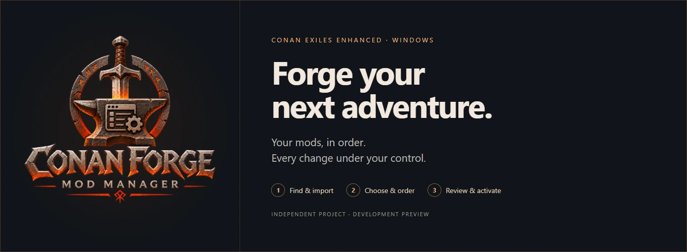
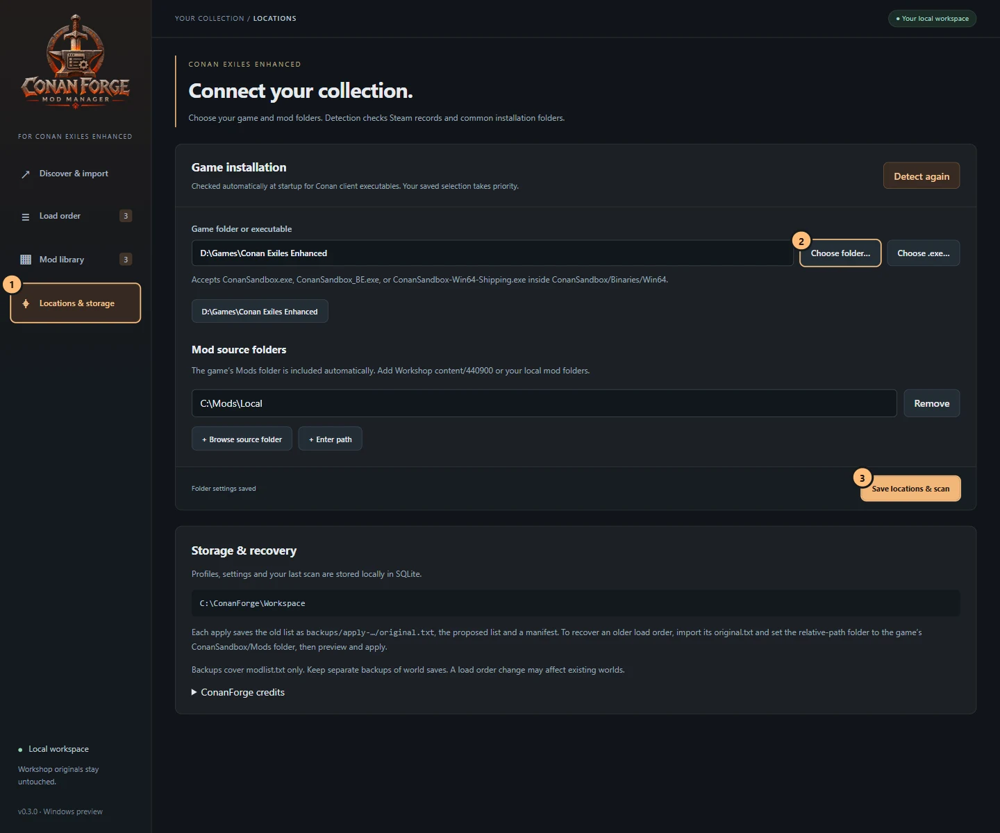
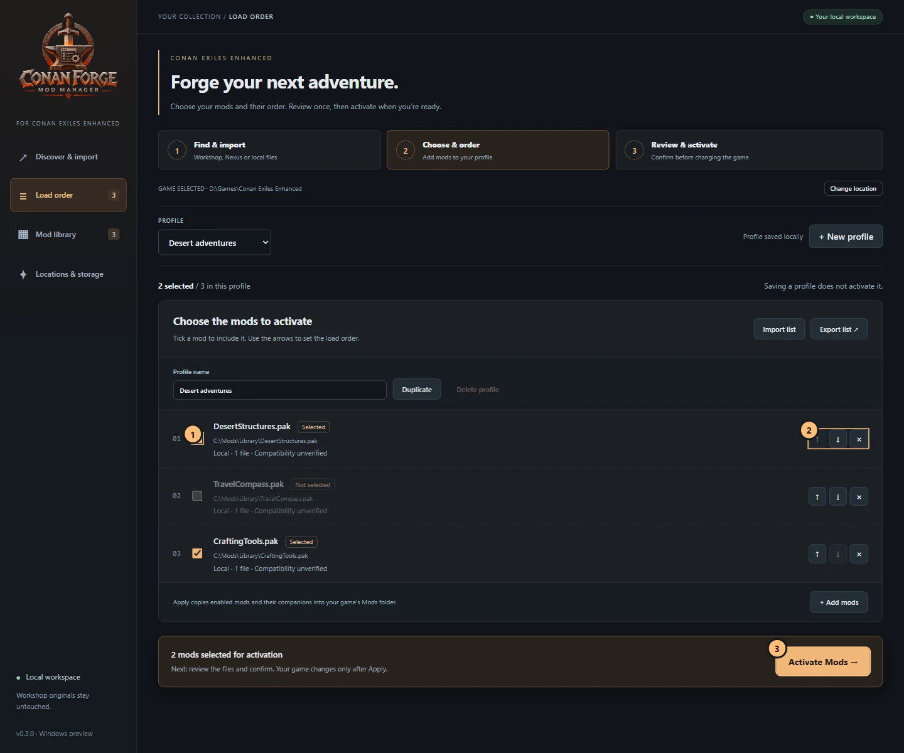
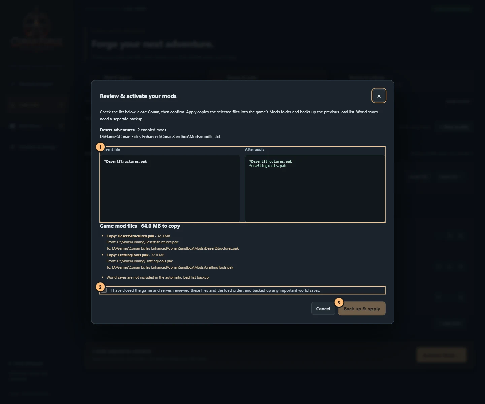
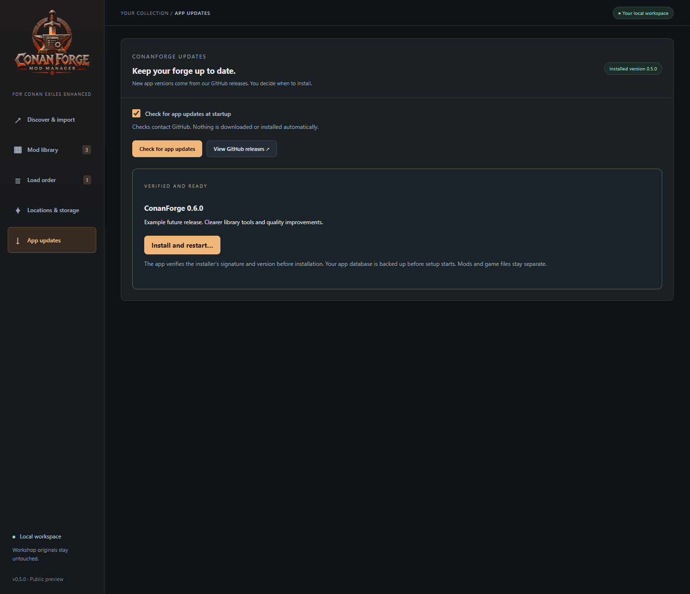
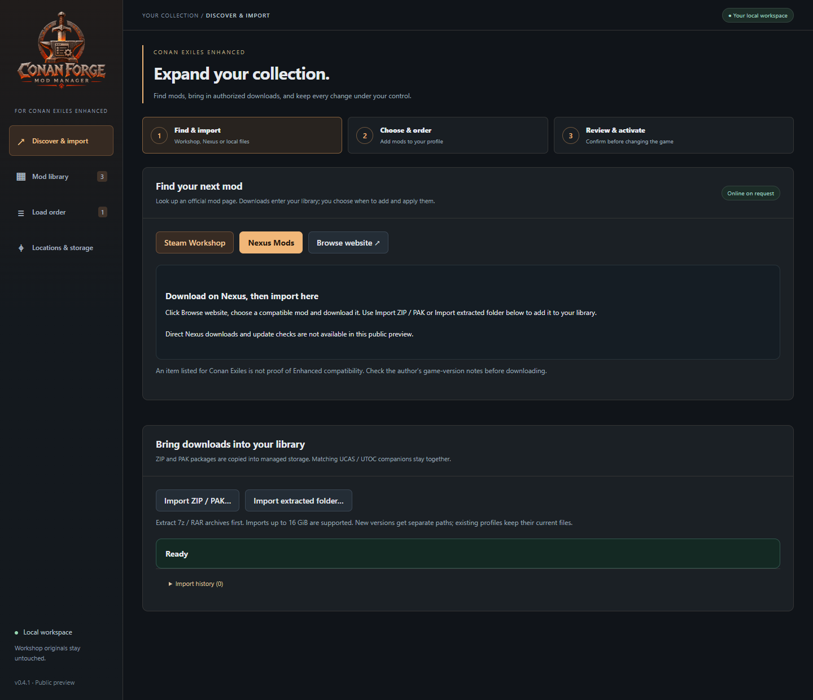

  

<h1 align="center">ConanForge Mod Manager</h1>

<strong>A Windows workspace for Conan Exiles Enhanced mods.</strong> Bring in your mods, build a load order, and review every change before it reaches your game.

  <a href="docs/USER-GUIDE.md"><strong>Illustrated user guide</strong></a> ·
  <a href="https://github.com/MiMat82/Conan-Forge---Mod-Manager/releases/download/v0.5.0/ConanForge-v0.5.0-windows-x64-setup.exe"><strong>Download Windows installer</strong></a> ·
  <a href="docs/ROADMAP.md">Development roadmap</a> ·
  <a href="https://github.com/MiMat82/Conan-Forge---Mod-Manager/issues">Feedback</a>

---

## Your collection, under your control

*Real interface with fictional example packages and neutral folders. The numbered walkthrough images retain the v0.3.0 layout; the library and Nexus screenshots below show v0.4.1. These are not mod recommendations.*

| Find your mods | Shape your load order | Review and activate |
| --- | --- | --- |
| Look up Steam Workshop items by URL or ID. Import authorized Nexus downloads, ZIPs, PAKs or extracted folders. | Keep ordered profiles, tick the mods you want, and move them with the arrow buttons. | See the file-copy plan and load-list changes. Confirm explicitly before applying. |
| SteamCMD is found or set up automatically when needed. | Saving a profile does **not** activate it. | The previous load list is backed up; Workshop originals stay untouched. |

## From download to your next adventure

**1 · Find & import** 
Open **Discover & import**. Use a Workshop URL or item number, or import a mod you downloaded from Nexus or another author-approved source. Downloads enter the manager's library.

**2 · Choose & order** 
Open **Mod library**, click **+ Add to profile**, then open **Load order**. Tick the packages to activate and arrange them top to bottom.

**3 · Review & activate** 
Click **Activate Mods**. Review the proposed changes, close the game, tick the confirmation and choose **Back up & apply**. Restart Conan to load the selection.

[Follow the illustrated guide, with numbered click targets →](docs/USER-GUIDE.md)

## Look inside

| Connect your game | Find a Workshop mod |
| --- | --- |
|  |  |
| **Detected automatically, selectable manually.** Choose a game folder or supported Conan executable. | **A URL or a number gets you started.** SteamCMD setup happens when the download needs it. |

| Choose what to load | See exactly what changes |
| --- | --- |
|  |  |
| **Selected means selected.** A profile is a plan until you apply it. | **Confirm the final step.** Package copies and the load list are reviewed together. |

## Built around your local workspace

- **Game detection:** checks Steam records and common installation folders; accepts a manually selected folder or executable.
- **Local library:** scans `.pak` packages and matching `.ucas` / `.utoc` companions.
- **Library maintenance:** check tracked Workshop downloads for updates; review and delete unused imported bundles. Game-installed copies remain separate.
- **Profiles:** save, duplicate, rename, reorder and switch between mod selections.
- **Load lists:** import and export `modlist.txt`.
- **Controlled installation:** copies selected packages into `ConanSandbox/Mods`, reuses identical files, and blocks conflicting files instead of overwriting them.
- **App updates:** startup notification, release notes, a verified download and explicit installation/restart. Existing v0.4.1 users install v0.5.0 manually once.
- **ConanForge identity:** transparent logo intro, three brief smithing strikes, a Skip control and a matching Windows icon.
- **Under the hood:** Tauri 2, Rust, TypeScript/React and local SQLite storage.

## Availability

**Public preview: v0.5.0 for Windows x64.** [Download the EXE installer](https://github.com/MiMat82/Conan-Forge---Mod-Manager/releases/download/v0.5.0/ConanForge-v0.5.0-windows-x64-setup.exe), run the setup wizard, then open **ConanForge Mod Manager** from the Start menu. Setup installs for your current Windows user and downloads Microsoft WebView2 if needed (internet required). Windows Authenticode signing is not yet included; the installer has a separate signature verified by the in-app updater.

Prefer a portable app? The [Windows ZIP remains available](https://github.com/MiMat82/Conan-Forge---Mod-Manager/releases/download/v0.5.0/ConanForge-v0.5.0-windows-x64.zip): extract the whole folder and run **ConanForge.exe**. [Installation and removal instructions](docs/INSTALLER.md). Neither download includes mods or game files.

The release includes checksums, source code and third-party notices. **Nexus uses browser download and manual import in this public build.** Direct Nexus API downloads and update checks await application registration and account testing. Clean-machine installation and every mod combination have not been qualified. See the [release notes](docs/RELEASE-v0.5.0.md) and [roadmap](docs/ROADMAP.md).

### App updates in v0.5.0

*Illustrated with a fictional future version; it is not an available release. [How app updates work →](docs/INSTALLER.md#update-from-the-app)*

### Library maintenance in v0.4.1

### Nexus browser imports

## Build and contribute

The original source and documentation are available under the [MIT license](LICENSE). Branding is not a grant of trademark rights; the startup sound and dependencies retain their [third-party terms](THIRD_PARTY_NOTICES.md).

On Windows, install Node.js 26, Rust/rustup, Visual Studio C++ build tools and WebView2. The repository pins its Rust toolchain. Run `npm ci`, then `npm run tauri dev`. See [development instructions](docs/DEVELOPMENT.md) for tests and release builds.

## Know what is protected

The manager preserves subscribed Workshop originals and backs up the previous **load list** when applying changes. It does **not** back up world saves or determine whether a mod is compatible with Enhanced. Back up `ConanSandbox/Saved` separately and check each author's compatibility and load-order instructions.

Changing or removing mods can affect an existing world. Automatic mod updates, dependency resolution and server management are not included in this preview.

---

An independent community project. Not affiliated with or endorsed by Funcom, Valve or Nexus Mods. 
[Artwork and sound credits](docs/CREDITS.md) · [Usage and troubleshooting](docs/USER-GUIDE.md)
