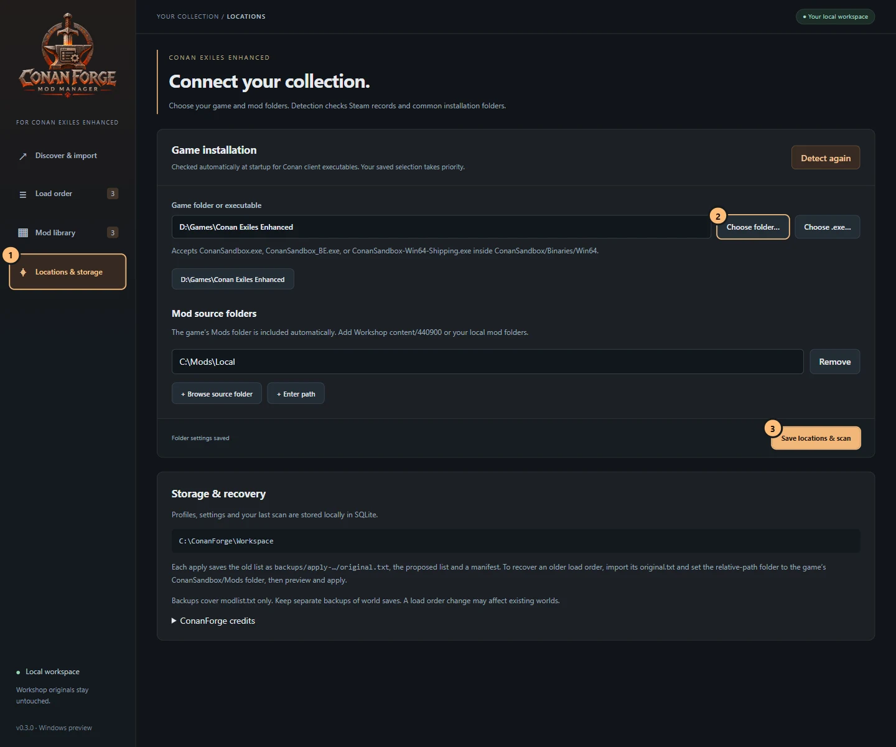
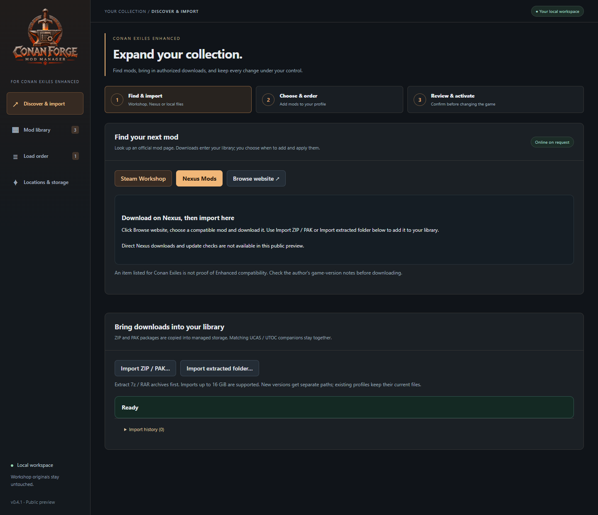
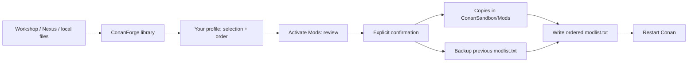

# ConanForge: illustrated user guide

**For the v0.5.1 public preview.** Follow the numbered circles in the walkthrough images, which retain the v0.3.0 layout. Library and Nexus images show v0.4.1; the app-update image shows v0.5.0 with a fictional future update. All images use fictional example mods and neutral paths; your filenames, folders and sizes will differ. The pictured Workshop number is an example, not a recommended download.

[Back to the product page](../README.md) · [Roadmap](ROADMAP.md)

## Before you start

The application requires Windows x64, the Microsoft Edge WebView2 runtime and a Conan Exiles client installation. Online downloads also need internet access; scanning, profiles and local imports work locally.

Get the package from the [official v0.5.1 release](https://github.com/MiMat82/Conan-Forge---Mod-Manager/releases/tag/v0.5.1):

1. Download **`ConanForge-v0.5.1-windows-x64-setup.exe`**. The source ZIP is for developers.
2. Run the setup wizard, review the license and choose the installation folder. Setup creates a Start menu shortcut and an entry in Windows Installed apps.
3. Open **ConanForge Mod Manager** from the Start menu or the setup wizard's Finish page.
4. The transparent logo intro plays three short smithing strikes, then opens the manager. **Skip intro**, **Escape** or **Enter** opens it immediately.

Setup installs for your current user and downloads Microsoft WebView2 if it is missing; internet is needed for that step. The preview is unsigned, so Windows may show an unknown-publisher warning. Do not disable Windows protection to run an untrusted copy.

**Portable alternative:** download `ConanForge-v0.5.1-windows-x64.zip`, choose **Extract All**, and run `ConanForge.exe` from the extracted folder. Keep the documentation and license files. If needed, install the Evergreen Runtime from [Microsoft's WebView2 page](https://developer.microsoft.com/en-us/microsoft-edge/webview2/).

See [installation and removal](INSTALLER.md) for preserving your existing profiles and imported library.

Before changing an established mod setup, make a separate copy of `ConanSandbox/Saved`. ConanForge's automatic backups cover the load list, not your world or character.

## 1. Connect your game



ConanForge looks for supported Conan client installations at startup. A saved manual choice takes priority. If exactly one installation is found on first use, it is selected automatically.

1. Open **Locations & storage**.
2. Check the game path. If it is missing or wrong, click **Choose folder…** or **Choose .exe…**.
3. Click **Save locations & scan**.

A typical game root is `D:\Games\Conan Exiles Enhanced`. You may also select a supported executable inside `ConanSandbox\Binaries\Win64`:

- `ConanSandbox.exe`
- `ConanSandbox_BE.exe`
- `ConanSandbox-Win64-Shipping.exe`

The manager resolves those paths to the game installation. If several installations are found, choose the one you actually use. **Detect again** repeats discovery.

The game's `ConanSandbox\Mods` folder is scanned automatically if present. To include existing local or subscribed Workshop downloads, click **+ Browse source folder**, choose the folder, then **Save locations & scan**.

A Steam Workshop source normally ends in:

```text
steamapps\workshop\content\440900
```

These source folders are read without changing the Workshop originals.

## 2. Get mods into your library

### Steam Workshop


Open **Discover & import**, then:

1. Select **Steam Workshop**.
2. Paste the author's Workshop item URL or its numeric ID. Replace the example number in the picture with your chosen item.
3. Click **Look up mod**. Review the title and author's page; confirm the mod supports your game version.
4. Click **Download to library** and wait for the transfer to finish.

**You do not need to find SteamCMD yourself.** The manager looks for a suitable launcher, or downloads the official launcher from Valve and verifies it when needed. Downloads run through a private working copy. It does not modify an existing SteamCMD installation or your subscribed Workshop folders.

Some Workshop items require account ownership and cannot be downloaded anonymously. For those, subscribe/download through Steam, then add the Workshop `440900` folder as a local scan source.

A completed download is in your **library**. It is not yet activated.

### Nexus Mods or a file you already downloaded



The public build uses browser downloads and local import. Select **Nexus Mods**, then **Browse website** to open the Enhanced catalog.

**Import a browser download**

1. Download a compatible mod from its author's page.
2. In **Discover & import**, click **Import ZIP / PAK…** or **Import extracted folder…**.
3. Select the downloaded file or extracted mod folder and wait for import to complete.

Keep matching `.ucas` and `.utoc` files beside the `.pak` when importing a package. Extract RAR and 7z archives first; this preview directly imports ZIP and PAK files.

Direct Nexus API connections, API downloads and automatic Nexus update checks are disabled in this public build while application registration and live-account testing are pending. You do not need to enter an API key to use browser downloads and imports.

The Legacy Conan catalog and Enhanced catalog are separate. Do not substitute a Legacy numeric ID into the Enhanced catalog.

Never include an API key or a private download link in a public issue.

## 3. Add mods to a profile


1. Open **Mod library** and click **+ Add to profile** on each package you want.
2. Open **Load order** to review the selection.

**Added ✓** means that source package is already in the selected profile. It does not mean it has been installed into the game.

Use the search field for filenames or Workshop IDs. **Scan folders** refreshes the library if you added files outside the app.

For another setup, use **+ New profile** or **Duplicate**. Choose a useful name such as “Solo building” or “Co-op world”. Save or discard unsaved edits before switching profiles.

### Check for updates (v0.4.0)

On a **Library copy** card, click **Check for updates**. The result includes the check time; checks happen only when requested and do not download or activate anything.

- **Workshop:** compares the item's current update timestamp with the timestamp recorded when ConanForge downloaded that copy. A changed timestamp can include changes to the item page, so review the source before downloading.
- **Nexus:** use **View source** to review updates manually. Automatic Nexus checks are disabled in the public build, including for older Nexus-tracked imports.
- **Local import:** without a recorded provider and file version, an automatic comparison is unavailable. Check the original download page.
- **External / game copy:** source files discovered by scanning are not managed downloads. Checks and deletion are available on the corresponding imported **Library copy**.

Use **View source** to inspect the mod page and **Discover & import** to download a version you choose. Downloads do not switch saved profiles or overwrite game files. Reviewed replacement of an older installed version, including package backups and restore, is the next planned phase. Current Apply still blocks conflicting files with different contents.

### Delete an imported library copy (v0.4.0)

1. Remove its entries from **every profile that uses them**, and save those profiles. Unticking an entry keeps its file reference, so it does not make that file deletable. Save or discard unfinished edits before opening deletion.
2. In **Mod library**, click **Delete library copy…**. Review the package names, number of files, total size and folder. An imported archive or folder can contain several packages; deletion covers that entire imported bundle and all its companions.
3. Click **Delete library copy permanently** only when that is what you intend. Cancel closes the review without deleting anything.

Deletion is blocked by saved profile references, direct references from the current game's load list, modified content, unexpected files, or redirected folders. It removes the app-owned copy and its library record; it does not delete Steam Workshop originals, source downloads or copies already installed in the game. To deactivate an installed mod, remove it from the selected load order and **Apply**. Game-installed package cleanup is a separate, future feature.


## 4. Choose and order your mods


1. Tick the mods you want to load. Unticked entries remain in the profile as **Not selected**.
2. Use **↑** and **↓** to arrange them. Follow the authors' dependency and load-order instructions; the manager does not infer the correct order.
3. Click **Activate Mods** when the selection is ready.

The selection count shows how many entries will be included. **Save profile** saves your plan locally; it does not change the game. **Activate Mods** saves outstanding profile edits and opens the review.

The **×** beside a row removes it from the profile. It does not delete the downloaded package or a previously installed game copy.

## 5. Review and activate


1. Compare **Current file** with **After apply**, and review the file-copy list and warnings.
2. Close Conan and any Conan server. Back up important world saves separately, then tick the confirmation.
3. Click **Back up & apply**. If the selected files and load list are already identical, the action may say **Verify installed mods** instead.

The app checks the source files and destination again. If a file changed after preview, a different file uses the same target name, or the game is still running, resolve the reported problem and create a fresh preview.

On success, ConanForge reports completion and the backup location. **Restart Conan Exiles** to load the selection and refresh its in-game Mods menu.

Do not expect imported mods to appear in the game before this step.

## 6. Update ConanForge itself


1. Open **App updates**, or click **Review app update** in a startup notification. You can disable startup checks here and use **Check for app updates** manually.
2. Review the notes, then click **Download app update**. Downloading does not install it.
3. Save your edits and finish any mod downloads/imports. Choose **Install and restart…**, tick the confirmation and confirm installation.

ConanForge verifies the installer's signature and version, backs up its database, runs setup and reopens. Existing mods, profiles and game files are retained. If you use v0.4.1 or a portable copy, run the current Windows installer once first. See [installation and recovery details](INSTALLER.md).

This updates the manager application. Use **Mod library → Check for updates** to check a tracked Workshop mod instead.

## What happens to my files?



| Place | Purpose |
| --- | --- |
| `ConanSandbox/Mods` in the selected game | Applied PAK packages, matching companions and the active `modlist.txt`. |
| `ConanSandbox/Saved` | World/character saves. Keep a separate backup. |
| `%LOCALAPPDATA%\com.local.conanmodmanager\library` | Imported managed package versions. Profiles may refer to them. |
| `%LOCALAPPDATA%\com.local.conanmodmanager\manager.sqlite3` | Saved profiles, settings, scans and acquisition history. |
| `%LOCALAPPDATA%\com.local.conanmodmanager\backups` | Previous load lists and details of each apply. |

Apply uses local filenames such as `*ExampleMod.pak` in profile order. Identical game files are reused. Conflicting files are blocked. Disabled or unrelated packages already in the Mods folder are left in place, so they may remain visible in the game's available-mods list even when absent from the active load list.

A later change to a source file does not silently replace the installed game copy. Automatic replacement of game-installed mod files is not implemented. App updates are separate.

## Import, export and recovery

**Import an existing load list:** in **Load order**, click **Import list**, choose `modlist.txt`, and check the base folder used to resolve relative filenames. Missing packages must be resolved before activation.

**Export a profile:** click **Export list ↗** and choose a new `.txt` file outside the game. This exports the selected entries; it does not bundle or distribute the mod files.

**Recover an older load order:** locate the relevant backup's `original.txt`, import it into a profile, and set the base folder to the original game's `ConanSandbox/Mods` for relative filenames. Review and apply with the game closed. Packages referenced by that list must still be available. This restores the load order, not an earlier world save or deleted package version.

## Troubleshooting

| What you see | What to do |
| --- | --- |
| No game detected | Select the game folder or one of the supported client executables manually. Detection is bounded and does not search every folder on every drive. |
| Library is empty | Import your downloaded packages, or add the folder that actually contains them and run a scan. |
| Downloaded mod is missing in Conan | Add it to a profile, tick it, use Activate Mods, confirm Apply, then restart Conan. Check that the game path is the installation you launch. |
| Apply is disabled | Save changed folder settings; in the review, tick the confirmation after completing its checks. |
| Same-name file conflict | Inspect the conflicting versions and retain backups. This preview intentionally does not overwrite an existing different package. |
| Missing companion files | Put the matching UCAS/UTOC pair beside its PAK, then rescan or re-import the complete package. |
| Workshop requires a Steam account | Download through Steam and scan its Workshop folder. Authenticated SteamCMD login is not in this preview. |
| Mod is listed but causes problems | Check Enhanced support, dependencies and the author's load-order guidance. File scanning does not establish compatibility. |

For a report, include the app version, Windows version, exact error text and steps to reproduce. Remove personal paths, API keys and private links from screenshots/logs. [Open an issue](https://github.com/MiMat82/Conan-Forge---Mod-Manager/issues).

[Back to the product page](../README.md)
